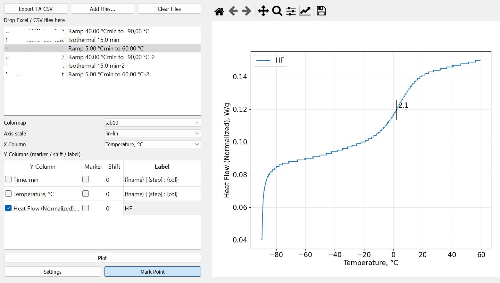

# DSC / mDSC Data Plotter

A desktop applet (PyQt5 + Matplotlib) to interactively plot **DSC** and **modulated DSC (mDSC)** data exported from TA Instruments.

It loads Excel or CSV files, turns every Excel sheet into a selectable *step*, and lets you compare files/steps/columns with an adaptive color / linestyle / marker encoding. It mirrors the behaviour of the `mDSC_plot.py` and `dsc_format-plot.py` scripts, but with a graphical interface.



## Features

- **Load** Excel (`.xls`, `.xlsx`, `.xlsm`, `.xlsb`) and CSV files — drag-and-drop or *Add Files...*
- **One dataset per Excel sheet** (each sheet = a step), labelled `sample | sheet`; `Details` / `Analysis` / `Notes` sheets are skipped
- **Multi-file / multi-step comparison** with automatic visual encoding (see below)
- **Selectable X column**
- **Selectable Y columns**, each with:
  - a **marker** toggle
  - a constant **shift** (offset applied only at plot time)
  - an editable **label** with placeholders
- **Axis scale**: `lin-lin`, `log-log`, `lin-log`, `log-lin`
- **Colormaps**: any Matplotlib colormap
- **Settings** dialog: font size + legend position (including *above plot*)
- **Mark Point** tool: click the plot to drop vertical markers showing the X value
- **Export TA CSV**: splits the sheets of TA Excel files into individual CSV files
- Embedded Matplotlib canvas with the standard navigation toolbar (pan/zoom/save)

## Visual encoding

Channels are assigned **only to the dimensions that actually vary**, in order `color → linestyle → marker`. This keeps every selection unambiguous without wasting a channel on a constant dimension.

| Varying dimensions | Color | Linestyle | Marker |
|--------------------|-------|-----------|--------|
| column only | column | – | – |
| file + column | file | column | – |
| step + column | step | column | – |
| file + step + column | file | step | column |

Linestyle cycle: `-`, `--`, `-.`, `:`, then finer dash patterns.

## File formats

### Excel (TA / DSC export)

| Row | Content |
|-----|---------|
| 1 | step / strategy comment |
| 2 | parameter names |
| 3 | measuring units |
| 4+ | data |

Columns are exposed as `Name, Unit` (e.g. `Temperature, °C`, `Heat Flow (Normalized), W/g`).

### CSV

| Row | Content |
|-----|---------|
| 1 | parameter names |
| 2 | units |
| 3+ | data |

The first two rows are combined into `Name, Unit` column names.

## Installation

Requires Python 3.9+.

```bash
git clone <this-repo>
cd app_dsc_plot
python -m venv venv
# activate:  source venv/bin/activate   (Linux/macOS)
#            venv\Scripts\activate      (Windows)
pip install -r requirements.txt
```

`openpyxl` is needed for `.xlsx`; `xlrd` for legacy `.xls`.

## Usage

1. **Launch**: `python main.py`
2. **Load data**: drag files in or click *Add Files...* — every sheet appears as a selectable dataset.
3. **Select datasets** (multi-select in the file list).
4. **X Column**: pick the horizontal axis.
5. **Y Columns**: tick the columns to plot and, per row, optionally:
   - toggle the **Marker**
   - type a **Shift** value
   - edit the **Label**
6. **Axis scale** and **Colormap** sit to the right of their labels.
7. Click **Plot**.

### Y-column label

Each Y row has a label cell. The default is the placeholder template:

```
{fname} | {step} : {col}
```

- `{fname}` → source file label
- `{step}` / `{stepname}` → sheet / step name
- `{col}` → Y column name

Type any text to use it verbatim as the legend label. **Delete everything** to fall back to the default template.

### Mark Point

- Click **Mark Point** (below *Plot*) to arm the tool (crosshair cursor).
- **Left click** on the plot: drops a short vertical line at the clicked X, centred on the click, labelled with the X value (`%.1f`). It does not need to land on a curve.
- **Right click**: removes the nearest vertical mark.
- Re-plotting clears all marks.

### Settings

Click **Settings** (below *Plot*) to adjust:

- **Font size** — applied to axis labels, tick labels and the legend.
- **Legend position** — `best`, corners, center, or **above plot**. *Above plot* starts as a single line and only wraps to multiple rows/columns when the entries would exceed the figure width.

## Project structure

```
app_dsc_plot/
├── main.py           # the applet
├── requirements.txt
├── screenshot.png
└── README.md
```

## Tips

- Comparison of several samples: select one step from each file → files get colors, columns get linestyles.
- Overlaying many steps of one sample: select a single file with several steps → steps get linestyles, columns get markers.
- Very long default labels produce tall above-plot legends; shorten them via the label column for a compact single line.

## License

MIT License